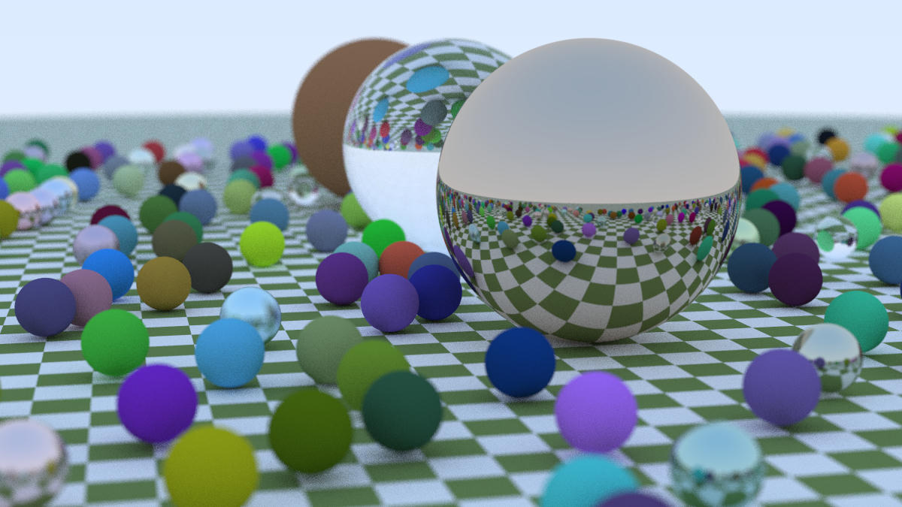

To re-familiarize myself with Rust, I felt it fitting to write a raytracer.
Based on the guide [RayTracing In One Weekend](https://raytracing.github.io/books/RayTracingInOneWeekend.html).

Example rendered image:

Possible to-do:
- [x] implement basics
- [x] reduce cloning
- [x] set up benchmarking test
- [x] Box overuse?
- [x] Rng
- [x] adjust to Rust
- [x] BVH
- [x] multithread
- [x] textures
- [x] quadrilaterals
- [x] disks
- [x] triangles
- [ ] lights
- [ ] instances
- [ ] volumes
- [ ] GUI
- [ ] controls, real-time preview

General optimization:
- [ ] investigate hot paths
- [ ] SIMD?
